# Plano Mestre: Transformação em Hub de Integrações (Estilo Pluga.co)

> **Status da Plataforma:** Produção atualizada com sucesso (Whazing intake e desacoplamento de agentes ativos na VPS `178.253.250.120`).  
> **Objetivo:** Avaliar a prontidão da arquitetura atual e traçar o roadmap completo para transformar o sistema em um **Hub de Integrações Multi-Canal e Multi-Apps** (semelhante ao modelo Pluga.co / Make / Zapier).

---

## 1. Avaliação Executiva: "Temos estrutura para isso?"

### Resposta Curta: **SIM, com folga!**
A arquitetura atual já possui aproximadamente **70% dos alicerces técnicos necessários** para um hub de integrações SaaS enterprise. O sistema não precisará ser reescrito; ele será **expandido** em camadas modulares.

### O que a plataforma JÁ TEM pronto:

```
                                ARQUITETURA EXISTENTE
┌─────────────────────────────────────────────────────────────────────────────┐
│ 1. Multi-tenancy RLS        │ Isolamento nativo por tenant_id no Postgres.   │
├─────────────────────────────┼───────────────────────────────────────────────┤
│ 2. Vault Criptografado      │ Gestão de credenciais (API Keys, OAuth 2.0).  │
├─────────────────────────────┼───────────────────────────────────────────────┤
│ 3. Inbound Delivery Engine  │ Deduplicação idempotente, tokens e HMAC.      │
├─────────────────────────────┼───────────────────────────────────────────────┤
│ 4. Outbound Webhooks Queue  │ Fila assíncrona com backoff e retentativas.   │
├─────────────────────────────┼───────────────────────────────────────────────┤
│ 5. Catálogo Desacoplado     │ `catalogType` dinâmico sem DDL a cada app.     │
├─────────────────────────────┼───────────────────────────────────────────────┤
│ 6. Suporte Nativo a MCP     │ Conexão com qualquer servidor MCP do ecossist.│
├─────────────────────────────┼───────────────────────────────────────────────┤
│ 7. Workers em Background    │ Bun runtime, jobs agendados, debouncers.      │
└─────────────────────────────────────────────────────────────────────────────┘
```

---

## 2. O que falta para se tornar uma Pluga.co? (Gap Analysis)

Hoje o sistema é focado em:
1. Agentes conversacionais de IA (LangGraph).
2. Canais diretos (Whazing, Chatwoot).
3. Webhooks externos que alimentam diretamente o agente (`InboundEventKind: conversion | status_update | agent_nudge`).

Para funcionar como a **Pluga.co**, precisamos habilitar o paradigma **Gatilho ➔ Filtro ➔ Ação** (Trigger-Action Automation), independente de a IA estar participando ou não.

```mermaid
flowchart LR
    subgraph GATILHOS ["1. Gatilhos (Triggers)"]
        W1["Whazing: Novo Lead"]
        W2["Whazing: Tag Adicionada"]
        W3["Whazing: Card Movido"]
        E1["App Externo: Compra Aprovada"]
        E2["App Externo: Formulário Preenchido"]
    end

    subgraph ENGINE ["2. Motor de Automações (O que vamos construir)"]
        EV["Barramento de Eventos (Event Bus)"]
        FILT["Filtros & Condições (Ex: Tag == VIP)"]
        MAP["Mapeador de Campos (Field Mapping)"]
        EV --> FILT --> MAP
    end

    subgraph ACOES ["3. Ações (Actions)"]
        A1["Google Sheets: Adicionar Linha"]
        A2["RD Station / CRM: Criar/Atualizar Lead"]
        A3["Whazing: Enviar WhatsApp"]
        A4["Slack / Discord: Notificar Canal"]
        A5["IA Agent: Iniciar Atendimento Ativo"]
    end

    GATILHOS --> EV
    MAP --> ACOES
```



---

## 3. Modelo de Dados Proposto (Prisma)

Para dar suporte ao fluxo configurável pelo cliente, adicionamos 3 modelos sem quebrar nenhuma tabela existente:

```prisma
// Regra de automação criada pelo usuário no painel
model AutomationRule {
  id          BigInt   @id @default(autoincrement())
  tenantId    BigInt   @map("tenant_id")
  name        String
  description String?
  enabled     Boolean  @default(true)

  // GATILHO (Trigger)
  triggerProvider String   @map("trigger_provider") // ex: "WHAZING", "TYPEFORM", "HOTMART", "WEBHOOK"
  triggerEvent    String   @map("trigger_event")    // ex: "lead.created", "tag.added", "purchase.approved"
  triggerConfig   Json     @default("{}")           // ex: { "instanceId": 12, "tag": "Interessado" }

  // FILTROS (Conditions)
  conditions      Json     @default("[]")           // ex: [{ "field": "lead.value", "op": "gte", "value": 500 }]

  // AÇÕES (Pipeline ordenado de ações)
  actions         AutomationAction[]
  executions      AutomationExecutionLog[]

  createdAt   DateTime @default(now()) @map("created_at")
  updatedAt   DateTime @updatedAt @map("updated_at")

  tenant      Tenant   @relation(fields: [tenantId], references: [id], onDelete: Cascade)

  @@index([tenantId])
  @@index([triggerProvider, triggerEvent])
  @@map("automation_rules")
}

// Ação individual que será disparada pela regra
model AutomationAction {
  id               BigInt         @id @default(autoincrement())
  ruleId           BigInt         @map("rule_id")
  order            Int            @default(0)
  actionProvider   String         @map("action_provider") // ex: "GOOGLE_SHEETS", "RD_STATION", "WHAZING"
  actionType       String         @map("action_type")     // ex: "append_row", "create_lead", "send_message"
  credentialRef    String?        @map("credential_ref")  // Referência ao Vault
  fieldMapping     Json           @default("{}")          // Mapeamento dinâmico: { "nome": "{{lead.name}}" }
  config           Json           @default("{}")

  rule             AutomationRule @relation(fields: [ruleId], references: [ruleId], onDelete: Cascade)

  @@index([ruleId])
  @@map("automation_actions")
}

// Histórico e rastreabilidade para o cliente acompanhar
model AutomationExecutionLog {
  id               BigInt         @id @default(autoincrement())
  tenantId         BigInt         @map("tenant_id")
  ruleId           BigInt         @map("rule_id")
  triggerPayload   Json           @default("{}")
  status           ExecutionStatus // SUCCESS, FAILED, SKIPPED_CONDITION
  executionSteps   Json           @default("[]") // Detalhes de cada ação executada
  errorMessage     String?        @map("error_message")
  durationMs       Int            @default(0)
  createdAt        DateTime       @default(now()) @map("created_at")

  tenant           Tenant         @relation(fields: [tenantId], references: [id], onDelete: Cascade)
  rule             AutomationRule @relation(fields: [ruleId], references: [ruleId], onDelete: Cascade)

  @@index([tenantId, ruleId])
  @@index([createdAt])
  @@map("automation_execution_logs")
}

enum ExecutionStatus {
  SUCCESS
  FAILED
  SKIPPED_CONDITION
  PENDING
}
```

---

## 4. Roadmap de Implementação em 4 Fases

### Fase 1: Barramento de Eventos e Abstração de Canais (Base)
- **Objetivo:** Fazer com que o Whazing e qualquer canal futuro emitam eventos padronizados no sistema.
- **Eventos Padronizados de Canal:**
  - `channel.lead.created` (Novo contato/lead capturado)
  - `channel.tag.added` (Tag aplicada no contato)
  - `channel.stage.changed` (Movimentação no Kanban de atendimento)
  - `channel.message.received` (Mensagem recebida com intenção específica)
- **Desacoplamento:** O Whazing Webhook Controller apenas publica o evento no `TenantEventBus`.

### Fase 2: Motor de Regras e Mapeamento de Campos (Core Engine)
- **Objetivo:** Processar regras assincronamente com garantia de entrega e sem travar a API principal.
- **Componentes:**
  - `RuleMatcher`: Avalia se o evento recebido atende às condições da regra (ex: `tag == 'Comprar'`).
  - `TemplateInterpolator`: Resolve variáveis dinâmicas (ex: `"Olá {{contact.name}}, seu código é {{payload.code}}"`).
  - `AutomationWorker`: Worker em segundo plano para executar as ações com retry automático.

### Fase 3: Catálogo de Conectores (App Connectors)
- **Conectores Iniciais Essenciais (MVP Pluga):**
  1. **Webhook Genérico (Entrada e Saída):** O "coringa" que permite conectar instantaneamente com qualquer ferramenta que tenha API/Webhook.
  2. **Google Sheets:** Adicionar linhas automaticamente (aproveitando o OAuth de Google que já temos no Vault).
  3. **CRMs Brasileiros:** RD Station, Pipedrive e HubSpot (criação de oportunidade e lead).
  4. **Plataformas de Pagamento / Infoproduto:** Kiwify, Hotmart, Eduzz e Asaas (gatilho de compra aprovada ➔ envio de WhatsApp automático pelo Whazing).
  5. **Whazing Actions:** Enviar mensagem de texto/áudio, adicionar tag, atribuir atendente ou transferir fila.

### Fase 4: Interface do Usuário no Painel (Studio de Integrações)
- **Páginas no Frontend React:**
  - **Catálogo de Apps:** Visual estilo Pluga/Make com cartões dos aplicativos disponíveis e status de conexão.
  - **Construtor de Automação:**
    - Passo 1: Selecionar o Gatilho (ex: Whazing ➔ Lead ganha tag "VIP").
    - Passo 2: Definir Filtro (opcional).
    - Passo 3: Selecionar o App de Destino e Ação (ex: Criar lead no RD Station).
    - Passo 4: Mapear os campos com chips visuais (`[Nome]`, `[Telefone]`, `[Email]`).
  - **Aba de Histórico / Logs:** Visão em tempo real de cada execução, com status de sucesso/erro e opção de reexecutar falhas.

---

## 5. Como os Canais Futuros se Encaixam?

A abstração criada para o Whazing servirá de modelo idêntico para qualquer novo canal:
```
           ┌──────────────────────┐
           │ Whazing (WhatsApp)   │──┐
           └──────────────────────┘  │
           ┌──────────────────────┐  │     ┌────────────────────────┐
           │ WhatsApp Cloud API   │──┼────▶│  Canal Padronizado     │──▶ [Automation Engine]
           └──────────────────────┘  │     │  (Event Envelope)      │
           ┌──────────────────────┐  │     └────────────────────────┘
           │ Instagram Direct     │──┤
           └──────────────────────┘  │
           ┌──────────────────────┐  │
           │ Chatwoot / Webchat   │──┘
           └──────────────────────┘
```
Ao conectar um novo canal (ex: Instagram Direct), basta implementar o adaptador que converte o webhook do canal no `NormalizedChannelEvent`. **Todas as automações e integrações existentes passam a funcionar automaticamente para o novo canal sem alterar uma única linha das ações!**

---

## 6. Diferencial Único vs. Pluga.co e Zapier: Automação Inteligente (IA)

Na Pluga e Zapier tradicionais, as regras são puramente rígidas e determinísticas (se A, faça B).  
Na nossa plataforma, teremos um superpoder exclusivo: **Ações de IA Embutidas**:
- **Ação: "Classificar com IA":** O lead mandou uma mensagem ➔ A IA lê o texto e decide a categoria (ex: "Urgente", "Dúvida Comercial", "Reclamação") ➔ A regra envia para o CRM já com o status correto.
- **Ação: "Extrair Dados com IA":** O cliente mandou um comprovante ou dados no chat ➔ A IA extrai CPF, CNPJ ou endereço e envia direto para o Google Sheets.

---

## 7. Próximos Passos Recomendados

1. **Validação do Escopo do MVP:** Definir os 3 primeiros conectores prioritários para os clientes atuais do Whazing (Exemplo sugerido: **Whazing ➔ Webhook Externo**, **Whazing ➔ Google Sheets**, **Hotmart/Kiwify ➔ Whazing**).
2. **Implementação da Fase 1 (Tabelas e Event Bus):** Criar a migração Prisma com as tabelas de automação e o emitter no intake do Whazing.
3. **Desenvolvimento da Interface no Painel:** Criar a tela de gestão de automações no menu lateral do painel.
